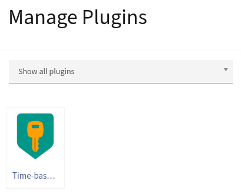
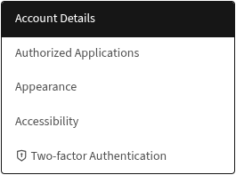
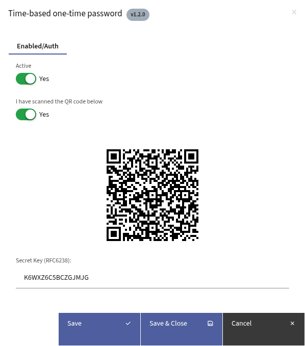

# Mautic TOTP Plugin

This plugin adds two-factor authentication (2FA) to Mautic. It uses time-based one-time passwords (TOTP).

This plugin is offered by FireMultimedia.
Would you like to use Mautic worry-free, with built-in extra features like this plugin? Get in touch with us at https://www.firemultimedia.nl/mautic-hosting/.

## Requirements
- Mautic 7.2.2 or later. Earlier versions are not supported.
- PHP 8.3 or later.
- An authenticator app that supports TOTP. Examples are Google Authenticator, Microsoft Authenticator, and [Aegis](https://getaegis.app/).

## Installation
1. In the main directory of the Mautic installation, run `composer require firemultimedia/mautic-totp-bundle`.
2. Clear the cache with `php bin/console cache:clear`.
3. Go to the **Plugins** page.
4. Click **Install/Upgrade Plugins**.

The new plugin appears on the **Plugins** page.

## Configuration
Each user configures TOTP for their own account.

1. Open the plugin from the **Plugins** page, or use the setup button on your **Account** page.  
   
2. Scan the QR code with your authenticator app. You can also copy the secret key into the app by hand.  
   
3. Set the scanned option to **Yes**.
4. Save the settings.

TOTP is now active for your account.

## Usage
After you activate TOTP, Mautic asks for a code each time you log in.

1. Log in to Mautic as usual.
2. Mautic shows the one-time password page.
3. Enter the 6-digit code from your authenticator app.

If the code is correct, Mautic opens the dashboard. If the code is not correct, Mautic shows an error. Enter a new code.

## How it works

- The plugin makes a secret key for each user. It stores the key in the plugin settings of Mautic.
- The plugin makes a new 6-digit code every 30 seconds.
- Mautic accepts the code for the current 30-second period. It also accepts the code for the period before and the period after. This allows for small clock differences.
- When the code is correct, Mautic saves this in your session. You do not enter the code again until the next login.
- Mautic does not ask for a code on the login pages, the OTP pages, and the API.

## Limits
- The plugin has no recovery codes. Keep a backup of your secret key in a safe place.
- If you unpublish the plugin, TOTP stops for all users.
- The plugin does not protect API requests.

## Changelog
Refer to [CHANGELOG.md](CHANGELOG.md).

## License
This plugin uses the GPL-3.0-only license. Refer to [LICENSE](LICENSE).
